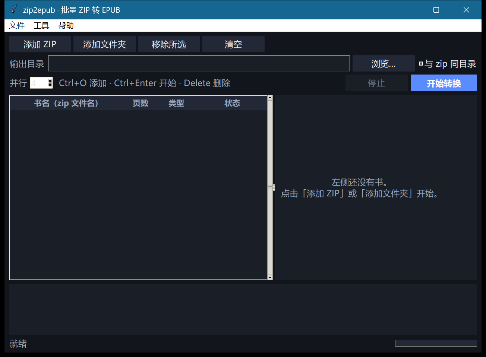
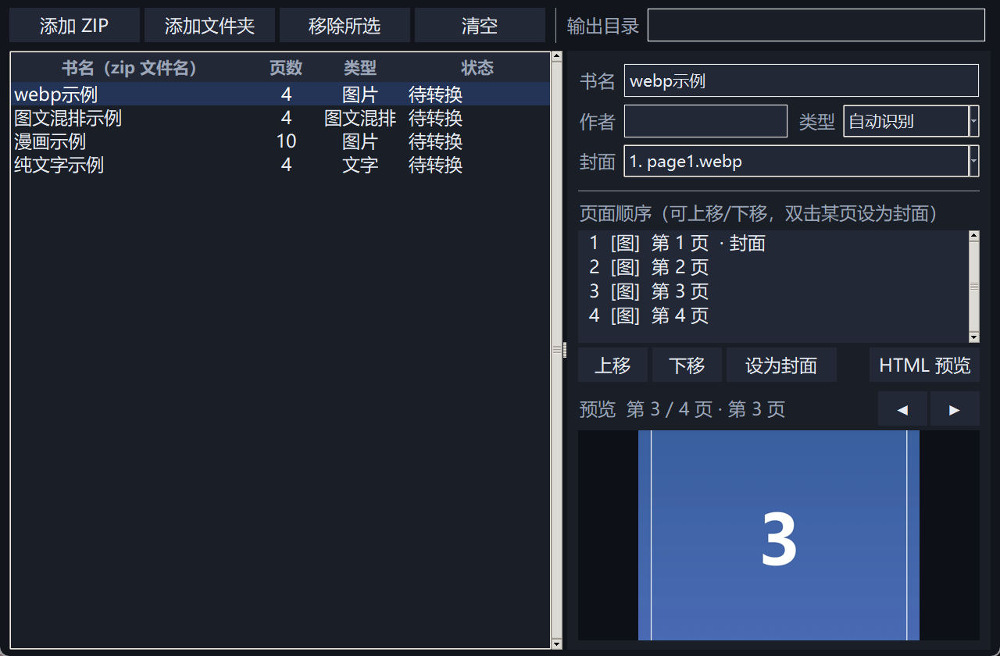
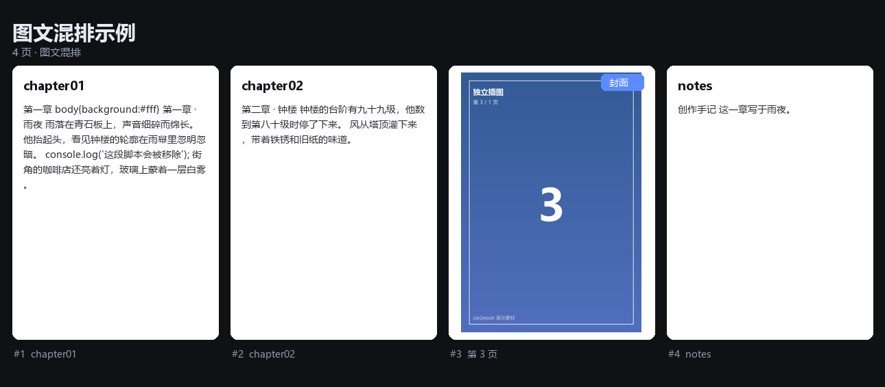

# zip2epub

> 批量把 ZIP 里的图片按顺序装订成 EPUB 3，带编辑与预览 · 纯本地 / 无联网 / 无内容审查



## 它解决什么

一堆漫画、图集、连载按 `01.png … 120.png` 放在 zip 里，拖进阅读器要么不认，要么顺序乱。
zip2epub 把 **多个 zip 并行**转成标准 EPUB 3：书名取 zip 文件名、封面取首张图片，
并把图片、纯文字、图文混排都排成一条可编辑的页面序列。

| 图片书（一页一图） | 图文混排（章节 + 插图 + 独立图片页） |
| --- | --- |
|  |  |

## 功能

- **批量**：一次加入多个 zip 或整个文件夹，按 `并行` 数同时转换；单本失败不影响整批
- **书名**：直接用 zip 文件名（保留中文与空格），可逐本改
- **封面**：默认取第一张图片，可下拉改选，或双击某页「设为封面」；没有图片时自动生成文字封面
- **排序**：自然排序（`2` 在 `10` 前、`01` 在 `1` 后），页面可上移/下移
- **三种模式**（自动识别，也可手动切换）
  - 图片：一图一页
  - 文字：每个 `txt / md / html` 一章
  - 混排：章节与独立图片按文件名顺序交错；HTML 里 `` 引用的图随章节走，不会被重复成页
- **编辑**：书名、作者、类型、封面、页面顺序；章节标题取自文件名，可预览校对
- **预览**：内置页面预览（图片缩放 / 文字排版），另可一键生成完全离线的单文件 HTML 预览（图片内嵌为 data URI）
- **本地**：不联网、不上传、不做任何内容过滤或改写；只做 EPUB 必需的技术性清理（去脚本、重写图片路径）
- **兼容**：EPUB 3（`nav.xhtml`）+ EPUB 2 回退（`toc.ncx`、`<meta name="cover">`），主流阅读器（Calibre、Apple Books、KOReader、静读天下等）可直接打开

## 快速开始

**直接用打包好的 exe（无需安装 Python）**

`dist/zip2epub.exe` —— 单个文件、无控制台窗口：

- **双击**：打开图形界面
- **从终端带参数**：走命令行，输出直接回到当前终端

```powershell
dist\zip2epub.exe --help
dist\zip2epub.exe convert D:\comics -o D:\books --jobs 4
```

从源码运行：

```powershell
pip install -r requirements.txt

python -m z2e.cli gui     # 图形界面
# 或者双击 run.bat
```

命令行：

```powershell
python -m z2e.cli convert D:\comics -o D:\books --jobs 4
python -m z2e.cli convert a.zip b.zip --force
python -m z2e.cli scan a.zip --json          # 查看解析结果
python -m z2e.cli preview a.zip -o a.html    # 离线 HTML 预览
python -m z2e.cli sheet a.zip -o a.png       # 缩略图联系表
```

## 打包为 exe

```powershell
.\build.ps1              # 首次会自动把 PyInstaller 装到 .pyi\，再生成单文件 exe
.\build.ps1 -Reinstall   # 强制重装 PyInstaller
```

- **单文件、无控制台窗口**，约 33 MB；内嵌 Python 3.12 + tkinter + Pillow + lxml
- 带图标与版本信息（资源管理器属性里可见 `zip2epub` / 1.0.0）
- 同一个 exe 兼顾两种入口：双击开 GUI；从终端带参数运行则把 stdout 接回该终端
- 打包版的数据目录是 `%LOCALAPPDATA%\zip2epub`（HTML 预览等），不写程序目录
- 启动时依赖会解包到 `%TEMP%\_MEIxxxxxx`，属 PyInstaller 单文件的正常行为


## 界面用法

1. **添加 ZIP / 添加文件夹** 后，左侧出现队列：书名、页数、类型、状态
2. 选中一本，右侧可改 **书名、作者、类型（自动识别 / 图片 / 文字）、封面**
3. **页面顺序**列表里选中某页，`上移 / 下移` 调整；双击某页直接设为封面
4. 下方 **预览** 区翻页查看；`HTML 预览` 会用默认浏览器打开离线预览页
5. 顶部选输出目录（默认与 zip 同目录），设并行数，点 **开始转换**
6. 转换中可停止；完成后可直接打开输出目录

> 转换时使用当前编辑状态的快照，转换过程中继续改别的书不会影响本次结果。

## 输出结构

```
mimetype                     application/epub+zip（不压缩，必须是第一个条目）
META-INF/container.xml
OEBPS/content.opf            EPUB 3 包文档（dc:title / cover-image / spine）
OEBPS/nav.xhtml              EPUB 3 目录 + landmarks
OEBPS/toc.ncx                EPUB 2 兼容目录
OEBPS/cover.xhtml            封面页
OEBPS/style.css
OEBPS/pages/p0001.xhtml …    正文页（图片页或章节）
OEBPS/images/img_0001.png …  统一重命名的图片
```

每次转换后内置自检：mimetype 位置与压缩方式、manifest 引用是否齐全、spine 是否为空、`dc:title` 是否存在。

## 实现要点

- **路径与排序**：`natural_key` 把文件名切成数字/文本片段，数字按数值比、`01` 与 `1` 用长度兜底；中文按 Unicode 稳定排序
- **模式判定**：有图无文 → 图片；有文无图 → 文字；两者都有 → 混排。混排时先解析每个 HTML 的 ``，解析到实际条目后从独立图片页里剔除，避免重复
- **编码**：BOM → HTML `charset` 声明 → UTF-8 → GB18030 → Big5，逐级尝试，永不因编码失败中断
- **图片**：jpg/png/gif 原样输出；webp/bmp/tiff/avif 用 Pillow 转成 png（带透明）或 jpg（质量 90）；动图保留 gif
- **HTML 章节**：用 lxml 解析，移除 `script/style/iframe` 与 `on*` 事件属性，重写图片为 `../images/...`，其余文字与结构原样保留
- **纯文本**：按空行切段；没有空行时按行切；中英混排时只在中英边界补空格
- **无图封面**：Pillow 本地绘制 1200×1800 渐变封面，书名自动换行

## 测试

```powershell
python -m unittest discover -s tests -v
```

18 项：自然排序、垃圾文件过滤、三种模式判定、混排去重、封面默认值、GB18030 解码、
EPUB 结构（mimetype 顺序 / OPF / spine 数量 / cover-image / 图片重写 / 无脚本）、
WebP 转换、批量并行、同名 zip 不互相覆盖。

示例数据用 `python tools/make_samples.py` 重新生成（本地合成，不联网）。

## 目录

```
z2e/
  model.py     数据模型（Entry / Page / BookPlan）
  scan.py      扫描 zip、自然排序、模式判定、编码解码
  epub.py      EPUB 3 构建器 + 轻量自检
  convert.py   批量引擎（线程池、进度、失败隔离）
  preview.py   离线 HTML 预览、PNG 联系表
  cli.py       convert / scan / preview / sheet / gui
gui/app.py     tkinter 图形界面（队列 / 编辑 / 预览）
tests/         18 项单元测试
tools/         样本生成、GUI 冒烟与截图脚本
```

## 边界

- 不处理加密或带密码的 zip；不解析 PDF/EPUB 输入
- 图片按原尺寸嵌入（不做压缩/切分），超大图集生成的 EPUB 会相应偏大
- HTML 只做技术性清理，不重排复杂 CSS 布局；依赖脚本的章节会退化为静态内容
- 没有联网功能：不查元数据、不下载封面、不做内容审查或改写
